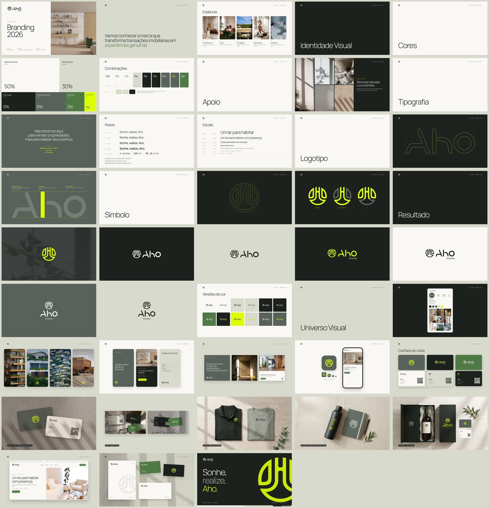

# Apresentação · Branding 2026

[`aho-imoveis-branding-2026.pdf`](aho-imoveis-branding-2026.pdf): 43 slides em 16:9 (1920 × 1080), na mesma estrutura da apresentação de 2023 da KM Designer, atualizada com a paleta, a tipografia e os logos aprovados em 2026.

| Slides | Seção |
|---|---|
| 1–3 | Capa, manifesto, essência |
| 4–7 | Identidade Visual · Cores (paleta e combinações) |
| 8–9 | Apoio: texturas naturais com luz e sombra |
| 10–13 | Tipografia: manifesto, pesos, escala |
| 14–16 | Logotipo: grade e conceito |
| 17–19 | Símbolo: grade e três leituras |
| 20–28 | Resultado: versões do logo e versões de cor |
| 29–34 | Universo visual: Instagram, stories dos bairros, templates, posts, ícone e site mobile |
| 35–37 | Cartões de visita: arte com QR Code e fotos |
| 38–40 | Brindes: uniforme, kit escritório, kit presente |
| 41–42 | Site e papelaria |
| 43 | Encerramento: "Sonhe, realize, Aho." |

Fotos: ver [`CREDITOS.md`](CREDITOS.md).
