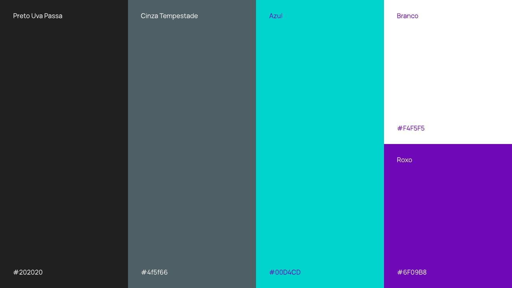

# Identidade 2023: KM Designer

**Cliente:** Diogo & Rafael · **Serviço:** Estratégia & Identidade Visual · **Estúdio:** KM Designer (kmdesigner.com.br) · **Ano:** 2023

Proposta: *"Vamos conhecer a marca que vai transformar transações imobiliárias em experiências genuínas."*

As páginas da apresentação original estão em [`referencias/2023-km-designer/`](../referencias/2023-km-designer/).

## Cores (2023)

| Nome | HEX |
|---|---|
| Preto uva passa | `#202020` |
| Cinza tempestade | `#4F5F66` |
| Azul (turquesa) | `#00D4CD` |
| Branco | `#F4F5F5` |
| Roxo | `#6F09B8` |

Apoio: fundo em degradê desfocado de preto para cinza tempestade, com textura granulada (página 7).

## Tipografia

- **Manrope** para textos (página 9).

## Logotipo

- Tipografia humanista: as curvas das letras trazem suavidade, equilíbrio, movimento e efetividade.
- Espaçamento: o espaço entre as letras deixa a tipografia moderna.
- A inicial maiúscula traz uma vibração mais acessível e casual.

Ver páginas 11–12.

## Símbolo

Monograma circular com três leituras (página 15):

1. **Monograma**: o círculo completo.
2. **Mãos agradecendo**: as formas verticais lembram mãos unidas.
3. **AHO**: as letras A, H e O formadas na parte superior.

## Versões do logo apresentadas

- Horizontal: símbolo + "Aho", com ou sem "imóveis" (páginas 18–21)
- Vertical: símbolo acima de "Aho imóveis" (páginas 22–23)
- Cores: turquesa sobre preto e preto sobre turquesa

## Universo visual

Perfil do Instagram, stories de lançamento (Pinheiros, Vila Mariana), posts, ícone de app, camiseta, site e papelaria: cartão, papel timbrado e envelope (páginas 25–32).

Bio do Instagram: *"sonhe, realize, aho! ↓ encontre seu imóvel · São Paulo, Brazil"*
