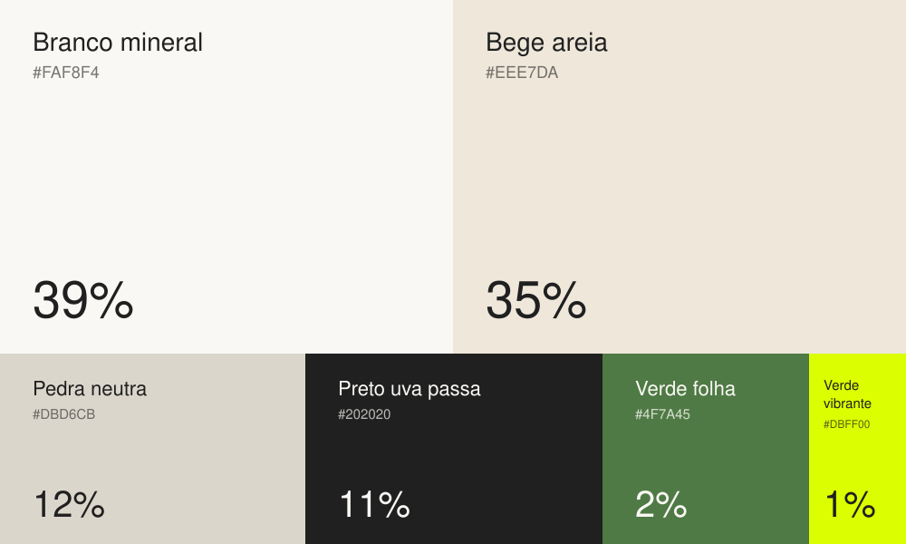

# Cores: paleta 2026

> Status: **em revisão**. Proposta definida por Diogo em outubro de 2026.

## Paleta e proporção de uso

| Cor | HEX | RGB | Proporção | Papel |
|---|---|---|---|---|
| Branco mineral | `#FAF8F4` | 250 248 244 | **39%** | Fundo principal |
| Bege areia | `#EEE7DA` | 238 231 218 | **35%** | Fundo secundário, blocos, cards |
| Pedra neutra | `#DBD6CB` | 219 214 203 | **12%** | Divisórias, bordas, áreas de apoio |
| Preto uva passa | `#202020` | 32 32 32 | **11%** | Texto, logotipo, fundos escuros pontuais |
| Verde folha | `#4F7A45` | 79 122 69 | **2%** | Cor de marca: botões, links, símbolo |
| Verde vibrante | `#DBFF00` | 219 255 0 | **1%** | Destaque: selos, chamadas, detalhes sobre escuro |

As proporções valem para o conjunto de uma peça ou de uma página: cerca de 86% neutros claros, 11% preto e 3% de verdes.

**CMYK e Pantone:** a definir com a gráfica antes da primeira impressão. O `#DBFF00` não reproduz bem em CMYK. Peça uma prova de cor ou use uma cor especial (Pantone).

## Contraste (WCAG 2.1)

Referência: **4,5:1** para texto normal (AA) e **3:1** para texto grande, ou seja, a partir de 24px, ou de 18,7px em negrito (AA).

| Texto ↓ / Fundo → | Branco mineral | Bege areia | Pedra neutra | Preto uva passa | Verde folha |
|---|---|---|---|---|---|
| **Preto uva passa** | ✅ 15,4 | ✅ 13,3 | ✅ 11,2 | — | ⚠️ 3,3 (só grande) |
| **Verde folha** | ✅ 4,7 | ⚠️ 4,1 (só grande) | ⚠️ 3,5 (só grande) | ⚠️ 3,3 (só grande) | — |
| **Verde vibrante** | ❌ 1,1 | ❌ 1,1 | ❌ 1,3 | ✅ 14,2 | ⚠️ 4,4 (só grande) |
| **Branco mineral** | — | ❌ 1,2 | ❌ 1,4 | ✅ 15,4 | ✅ 4,7 |

### Regras práticas

1. **Texto corrido** sempre em Preto uva passa sobre os neutros claros, ou em Branco mineral sobre o Preto.
2. **Verde folha** em texto só sobre Branco mineral. Sobre Bege areia ou Pedra neutra, use apenas em títulos grandes.
3. **Verde vibrante nunca aparece sobre fundo claro.** Use somente sobre Preto uva passa e, em tamanho grande, sobre Verde folha. Ele é a cor de destaque (1%), não uma cor de texto.
4. **Os três neutros (Branco, Bege, Pedra) servem para separar áreas e não para dar contraste.** Nunca coloque texto de um neutro sobre outro.
5. **Botão principal:** fundo Verde folha com texto Branco mineral (4,7:1). Sobre fundo escuro, pode ser fundo Verde vibrante com texto Preto (14,2:1).

## Combinações aprovadas

| Fundo | Logo / símbolo | Texto | Destaque |
|---|---|---|---|
| Branco mineral | Preto ou Verde folha | Preto | Verde folha |
| Bege areia | Preto | Preto | Verde folha (grande) |
| Preto uva passa | Branco mineral ou Verde vibrante | Branco mineral | Verde vibrante |
| Verde folha | Branco mineral | Branco mineral | — |
| Verde vibrante (selo) | Preto | Preto | — |

## O que mudou em relação a 2023

| 2023 | 2026 | Observação |
|---|---|---|
| Preto uva passa `#202020` | Preto uva passa `#202020` | **Mantido**: elo entre as duas fases |
| Branco `#F4F5F5` (frio) | Branco mineral `#FAF8F4` (quente) | Mais acolhedor |
| Cinza tempestade `#4F5F66` | Bege areia / Pedra neutra | Sai o cinza azulado, entram neutros quentes |
| Azul turquesa `#00D4CD` | Verde folha `#4F7A45` | **Muda a cor principal da marca** |
| Roxo `#6F09B8` | Verde vibrante `#DBFF00` | Novo destaque, usado com moderação |

Em resumo, a marca deixa de ser escura, tecnológica e vibrante e passa a ser **clara, natural e acolhedora**, com um único ponto de energia no verde vibrante.

Os valores oficiais para uso em código estão em [`tokens/cores.css`](../tokens/cores.css) e [`tokens/cores.json`](../tokens/cores.json).
