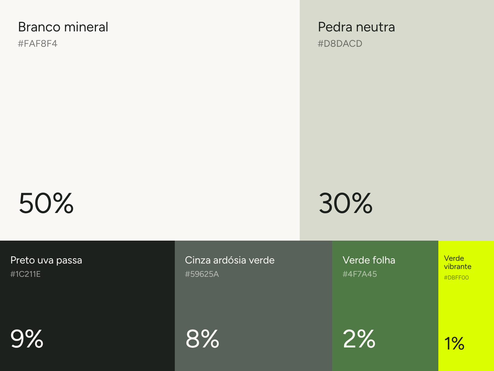

# Cores: paleta 2026

> Status: **aprovada**. Proposta definida por Diogo em outubro de 2026. Revisões: inclusão do Cinza ardósia verde, retirada do Bege areia e pigmento verde moderado na Pedra e no Preto.

## Paleta e proporção de uso

| Cor | HEX | RGB | Proporção | Papel |
|---|---|---|---|---|
| Branco mineral | `#FAF8F4` | 250 248 244 | **50%** | Fundo principal; a única cor quente da paleta |
| Pedra neutra | `#D8DACD` | 216 218 205 | **30%** | Fundo secundário, blocos, cards, bordas |
| Preto uva passa | `#1C211E` | 28 33 30 | **9%** | Texto, logotipo, fundos escuros |
| Cinza ardósia verde | `#59625A` | 89 98 90 | **8%** | Texto de apoio, fundos de seção, ponte entre neutros e verdes |
| Verde folha | `#4F7A45` | 79 122 69 | **2%** | Cor de marca: botões, links, símbolo |
| Verde vibrante | `#DBFF00` | 219 255 0 | **1%** | Destaque: selos, chamadas, detalhes sobre escuro |

As proporções valem para o conjunto de uma peça ou de uma página: 80% neutros claros, 17% escuros (preto + ardósia) e 3% de verdes.

A Pedra e o Preto têm um leve pigmento verde para conversar com a ardósia e os verdes. O Branco mineral continua quente, para a marca não ficar fria.

**CMYK e Pantone:** a definir com a gráfica antes da primeira impressão. O `#DBFF00` não reproduz bem em CMYK. Peça uma prova de cor ou use uma cor especial (Pantone).

## Contraste (WCAG 2.1)

Referência: **4,5:1** para texto normal (AA) e **3:1** para texto grande, ou seja, a partir de 24px, ou de 18,7px em negrito (AA).

| Texto ↓ / Fundo → | Branco mineral | Pedra neutra | Preto uva passa | Cinza ardósia | Verde folha |
|---|---|---|---|---|---|
| **Preto uva passa** | ✅ 15,4 | ✅ 11,5 | — | ❌ 2,6 | ⚠️ 3,3 (só grande) |
| **Cinza ardósia** | ✅ 6,0 | ⚠️ 4,5 (só grande) | ❌ 2,6 | — | ❌ 1,3 |
| **Verde folha** | ✅ 4,7 | ⚠️ 3,5 (só grande) | ⚠️ 3,3 (só grande) | ❌ 1,3 | — |
| **Verde vibrante** | ❌ 1,1 | ❌ 1,2 | ✅ 14,3 | ✅ 5,5 | ⚠️ 4,4 (só grande) |
| **Branco mineral** | — | ❌ 1,3 | ✅ 15,4 | ✅ 6,0 | ✅ 4,7 |

### Regras práticas

1. **Texto corrido** sempre em Preto uva passa sobre Branco ou Pedra, ou em Branco mineral sobre Preto ou ardósia.
2. **Cinza ardósia verde** é a cor dos textos de apoio (metragem, endereço, datas) sobre o Branco. Sobre a Pedra, use em tamanho grande. Também serve de fundo escuro alternativo ao Preto.
3. **Verde folha** em texto só sobre Branco mineral. Sobre a Pedra, apenas em títulos grandes.
4. **Verde vibrante nunca aparece sobre fundo claro.** Use sobre Preto ou ardósia e, em tamanho grande, sobre Verde folha. Ele é a cor de destaque (1%), não uma cor de texto.
5. **Branco e Pedra servem para separar áreas, não para dar contraste.** Nunca coloque texto de um sobre o outro.
6. **Não use ardósia, Preto e Verde folha como contraste entre si:** são escuros parecidos.
7. **Botão principal:** fundo Verde folha com texto Branco mineral (4,7:1). Sobre fundo escuro, fundo Verde vibrante com texto Preto (14,3:1).

## Combinações aprovadas

| Fundo | Logo / símbolo | Texto | Destaque |
|---|---|---|---|
| Branco mineral | Preto ou Verde folha | Preto (apoio em ardósia) | Verde folha |
| Pedra neutra | Preto ou Verde folha | Preto | Verde folha (grande) |
| Preto uva passa | Branco mineral, Pedra ou Verde vibrante | Branco mineral | Verde vibrante |
| Cinza ardósia verde | Branco mineral ou Verde vibrante | Branco mineral | Verde vibrante |
| Verde folha | Branco mineral | Branco mineral | — |
| Verde vibrante (selo) | Preto | Preto | — |

## O que mudou em relação a 2023

| 2023 | 2026 | Observação |
|---|---|---|
| Preto uva passa `#202020` | Preto uva passa `#1C211E` | Mantido, agora com leve pigmento verde |
| Branco `#F4F5F5` (frio) | Branco mineral `#FAF8F4` (quente) | Mais acolhedor |
| Cinza tempestade `#4F5F66` | Cinza ardósia verde `#59625A` | O cinza médio continua, agora puxando para o verde |
| — | Pedra neutra `#D8DACD` | Novo fundo secundário |
| Azul turquesa `#00D4CD` | Verde folha `#4F7A45` | **Muda a cor principal da marca** |
| Roxo `#6F09B8` | Verde vibrante `#DBFF00` | Novo destaque, usado com moderação |

Em resumo, a marca deixa de ser escura, tecnológica e vibrante e passa a ser **clara, natural e acolhedora**, com um único ponto de energia no verde vibrante.

### Histórico da paleta 2026

| Versão | Mudança |
|---|---|
| 1 | Branco 39 · Bege areia 35 · Pedra `#DBD6CB` 12 · Preto `#202020` 11 · Verde folha 2 · Verde vibrante 1 |
| 2 | Inclusão do Cinza ardósia verde (8%) |
| 3 | Retirada do Bege areia (muito próximo da Pedra); Pedra e Preto com pigmento verde moderado |

Os valores oficiais para uso em código estão em [`tokens/cores.css`](../tokens/cores.css) e [`tokens/cores.json`](../tokens/cores.json).
