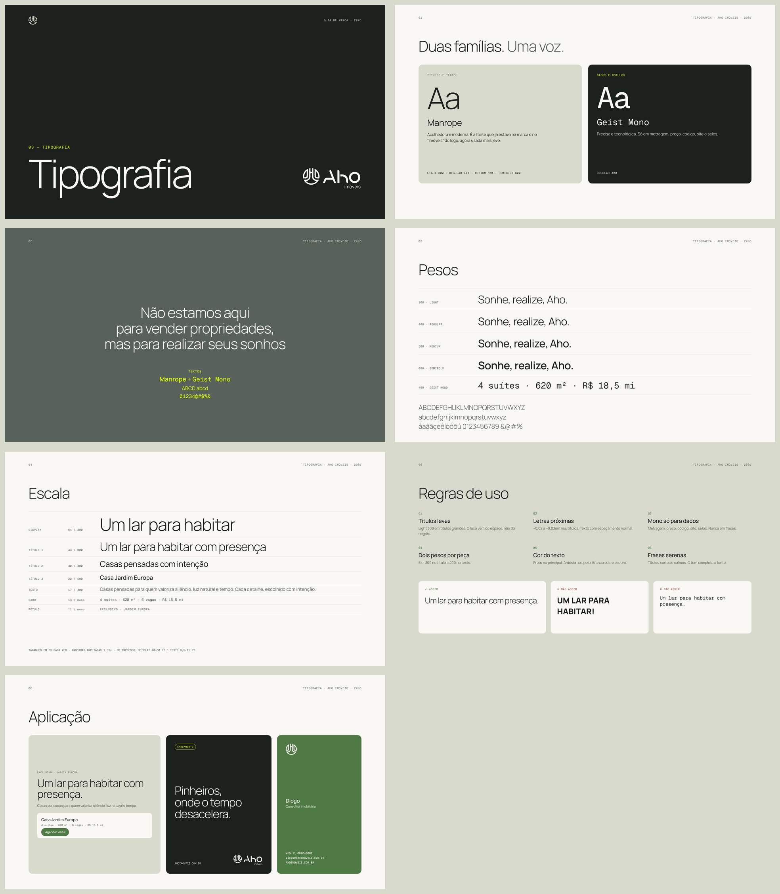

# Tipografia

> Status: **aprovada**: híbrida, **Manrope** + **Geist Mono**.

Guia visual: [`guia/03-tipografia.pdf`](../guia/03-tipografia.pdf)



## Famílias

| Família | Papel | Pesos usados | Licença |
|---|---|---|---|
| **Manrope** | Títulos, textos, botões | Light 300 · Regular 400 · Medium 500 · SemiBold 600 | Gratuita (SIL OFL) · [Google Fonts](https://fonts.google.com/specimen/Manrope) |
| **Geist Mono** | Somente dados e rótulos: metragem, preço, código do imóvel, endereço web, selos | Regular 400 | Gratuita (SIL OFL) · [Google Fonts](https://fonts.google.com/specimen/Geist+Mono) |

O "Aho" do logotipo é um desenho exclusivo e não uma fonte. O "imóveis" do logo está em Manrope Regular, então o logo e a tipografia da marca são da mesma família.

**Por que híbrida:** mantém a Manrope, que já era da marca e está no logo. O peso Light deixa a fonte mais silenciosa e sofisticada, e a Geist Mono traz o lado tecnológico só onde faz sentido, nos dados. O resultado é uma evolução, não uma ruptura.

## Escala (web)

| Estilo | Família | Tamanho | Peso | Entrelinha | Espaçamento |
|---|---|---|---|---|---|
| Display | Manrope | 64px | 300 | 1,0 | −0,03em |
| Título 1 | Manrope | 44px | 300 | 1,05 | −0,03em |
| Título 2 | Manrope | 30px | 400 | 1,15 | −0,02em |
| Título 3 | Manrope | 22px | 500 | 1,25 | −0,01em |
| Texto | Manrope | 16–18px | 400 | 1,55 | 0 |
| Texto pequeno | Manrope | 14px | 400 | 1,5 | 0 |
| Dado | Geist Mono | 13–14px | 400 | 1,4 | 0 |
| Rótulo / selo | Geist Mono | 11–12px | 400 | 1,2 | +0,08em, caixa alta |

No impresso, use as mesmas proporções. Por exemplo, Display em 40–60pt e texto em 9,5–11pt.

## Regras de uso

1. **Títulos leves.** Use Light (300) nos títulos grandes. O luxo silencioso vem do espaço e da leveza, não do negrito.
2. **Letras um pouco mais juntas nos títulos** (−0,02 a −0,03em). Nos textos, use o espaçamento normal.
3. **Mono só para dados.** Use em metragem, número de suítes, preço, código, site e selos ("EXCLUSIVO", "LANÇAMENTO"). **Nunca em frases ou parágrafos.**
4. **No máximo dois pesos de Manrope por peça.** Por exemplo, 300 no título e 400 no texto, ou 400 no texto e 600 em destaques.
5. **Cores do texto:** Preto musgo no texto principal, Cinza ardósia nos textos de apoio e dados, Branco mineral sobre fundos escuros. O Verde vibrante só em palavras de destaque sobre fundo escuro.
6. **Frases curtas e serenas** nos títulos ("Um lar para habitar com presença."). O tom de voz completa o que a fonte não diz.

## Uso no código

```css
@import url('https://fonts.googleapis.com/css2?family=Manrope:wght@300;400;500;600&family=Geist+Mono:wght@400&display=swap');

:root {
  --aho-fonte: 'Manrope', system-ui, sans-serif;
  --aho-fonte-dados: 'Geist Mono', ui-monospace, monospace;
}
```

## 2023: o que a apresentação original usava

| Uso | Fonte |
|---|---|
| Textos da marca | Manrope (confirmado: na apresentação e no arquivo de tipografia) |
| "imóveis" no logo | Manrope Regular (confirmado nos SVGs) |
| Títulos da apresentação | Uma sem serifa neutra, parecida com a Helvetica. É a fonte do modelo do estúdio, não da marca |

## Opções avaliadas e descartadas

| Opção | Motivo |
|---|---|
| Instrument Serif + Manrope | Elegante, mas a serifa afastava do lado jovem e tecnológico |
| Fraunces + Figtree | Acolhedora, mas pouco tecnológica e tirava a Manrope |
| Geist + Geist Mono | Muito tech e fria; exigiria redesenhar o "imóveis" do logo |
