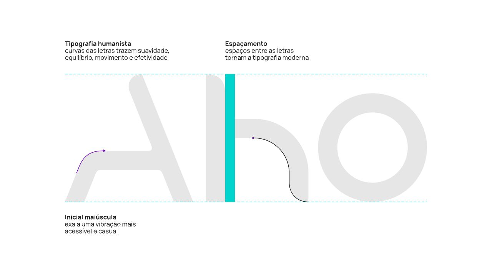
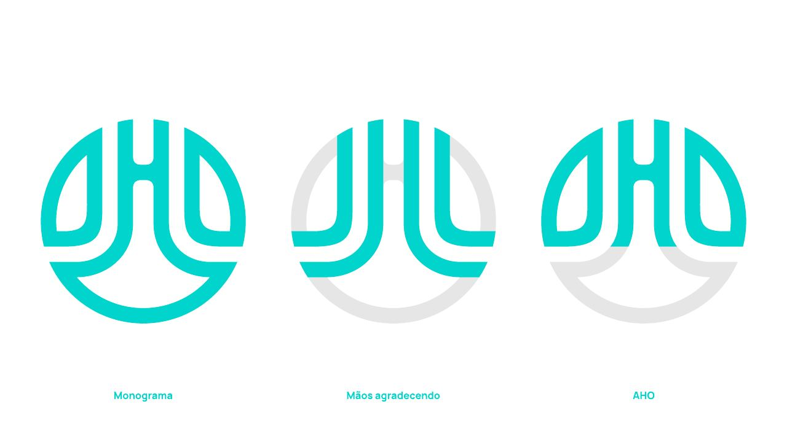

# Logotipo e símbolo

O desenho do logotipo e do símbolo de 2023 **continua o mesmo**. O que muda em 2026 são as **cores** em que eles aparecem.

## Versões

| Versão | Uso |
|---|---|
| Horizontal: símbolo + "Aho" | Site, assinatura de e-mail, rodapés |
| Horizontal com "imóveis" | Papelaria, documentos, primeira apresentação da marca |
| Vertical: símbolo sobre "Aho imóveis" | Peças quadradas e verticais, capas |
| Símbolo isolado | Avatar, ícone de app, favicon, marca d'água, selos |
| "Aho" isolado | Avatar do Instagram, peças em que o símbolo já aparece |

## Cores do logo (proposta 2026)

| Fundo | Cor do logo |
|---|---|
| Branco mineral / Bege areia / Pedra neutra | **Preto uva passa** (principal) ou Verde folha |
| Preto uva passa | **Branco mineral** ou Verde vibrante |
| Verde folha | Branco mineral |
| Foto | Branco mineral, com área escura suficiente atrás |

Evite:
- Logo em Verde vibrante sobre qualquer fundo claro, porque fica ilegível (contraste de 1,1:1).
- Logo em turquesa `#00D4CD`, cor que saiu da paleta.
- Esticar, girar, aplicar sombra ou contorno, ou trocar a fonte do "Aho".

## Área de proteção e tamanho mínimo

A definir com os arquivos vetoriais. Sugestão:
- **Área de proteção:** altura do "o" do "Aho" em volta de todo o logo.
- **Tamanho mínimo:** símbolo com 16px no digital e 8mm no impresso. Versão horizontal com 80px no digital e 25mm no impresso.

## Arquivos

Os arquivos oficiais ficam em [`logos/`](../logos/README.md).
