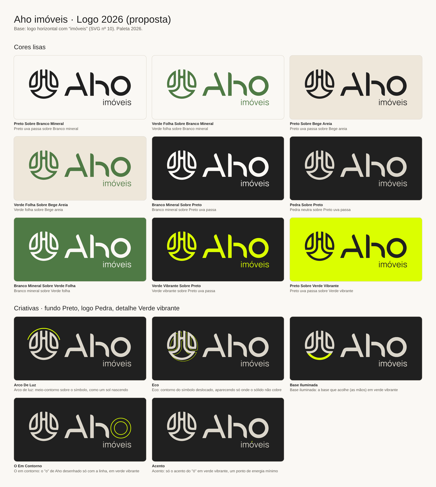

# Logo 2026: proposta para aprovação

Base: logo horizontal com "imóveis" (`logos/originais/10-horizontal-imoveis-roxo-fundo-branco.svg`), recolorido com a [paleta 2026](../../docs/02-cores.md).
O desenho não foi alterado. A palavra "imóveis" foi convertida de texto para desenho vetorial, para não depender da fonte Manrope instalada.

## Cores lisas (`cores-lisas/`)

| Arquivo | Logo | Fundo |
|---|---|---|
| 01 | Preto uva passa | Branco mineral |
| 02 | Verde folha | Branco mineral |
| 03 | Preto uva passa | Bege areia |
| 04 | Verde folha | Bege areia |
| 05 | Branco mineral | Preto uva passa |
| 06 | Pedra neutra | Preto uva passa |
| 07 | Branco mineral | Verde folha |
| 08 | Verde vibrante | Preto uva passa |
| 09 | Preto uva passa | Verde vibrante |

## Criativas (`criativas/`): fundo Preto, logo Pedra, detalhe Verde vibrante

| Arquivo | Ideia |
|---|---|
| A · Arco de luz | Meio-contorno sobre o símbolo, como um sol nascendo: "sonhe". |
| B · Eco | Contorno do símbolo deslocado atrás do sólido, como um movimento ou uma vibração. |
| C · Base iluminada | A base do símbolo, que acolhe as mãos, em verde vibrante: "realize". |
| D · O em contorno | O "o" de Aho desenhado só com a linha. |
| E · Acento | Só o acento do "ó", um ponto mínimo de energia. |

Status: **aguardando aprovação**. Depois da escolha, geramos o kit final com fundo transparente, versões de símbolo isolado e vertical, PNGs e área de proteção.
