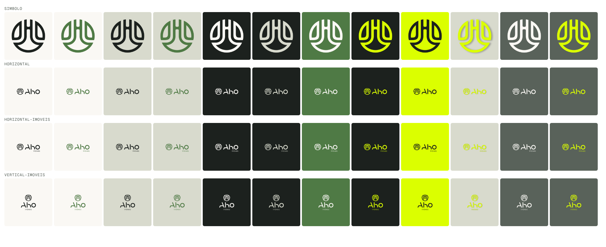

# Logos

## `2026/`: arquivos oficiais da paleta 2026

Paleta 2026 aprovada. Mesmo formato dos originais da KM Designer: SVG quadrado de 91,44 × 91,44 mm (viewBox 9144), com fundo colorido. A palavra "imóveis" está convertida em desenho vetorial, então não depende da fonte Manrope.

| Pasta | Tipo | Original usado como base |
|---|---|---|
| `simbolo/` | Símbolo isolado | `originais/04` |
| `horizontal/` | Símbolo + "Aho" | `originais/08` |
| `horizontal-imoveis/` | Símbolo + "Aho" + "imóveis" | `originais/12` |
| `vertical-imoveis/` | Símbolo sobre "Aho imóveis" | `originais/14` |

Cada pasta tem `svg/` e `png/` (2048 × 2048 px), com 12 versões de cor:

| Nº | Logo | Fundo |
|---|---|---|
| 01 | Preto musgo | Branco mineral |
| 02 | Verde folha | Branco mineral |
| 03 | Preto musgo | Pedra líquen |
| 04 | Verde folha | Pedra líquen |
| 05 | Branco mineral | Preto musgo |
| 06 | Pedra líquen | Preto musgo |
| 07 | Branco mineral | Verde folha |
| 08 | Verde vibrante | Preto musgo |
| 09 | Preto musgo | Verde vibrante |
| 10 | Verde vibrante + sombra lateral suave | Pedra líquen (somente em peças grandes) |
| 11 | Branco mineral | Cinza ardósia verde |
| 12 | Verde vibrante | Cinza ardósia verde |

Nome dos arquivos: `<tipo>-<nº>-<logo>-sobre-<fundo>.svg` / `.png`.

## `originais/`

Os 23 SVGs de 2023 (CorelDRAW), guardados sem alteração. O nº 16 não foi recebido.

## `2026-proposta/`

O quadro usado na aprovação das cores.

## Pendente

- Versões com fundo transparente
- Área de proteção e tamanho mínimo
